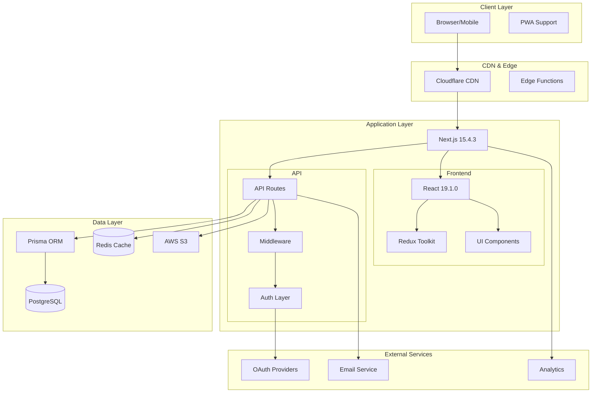

# 🏗️ Elice-Next Architecture Overview

## System Architecture



## Layer Architecture

### 1. Presentation Layer

#### Component Architecture
```
components/
├── features/          # Feature-specific components
│   ├── auth/         # Authentication components
│   ├── blog/         # Blog components
│   ├── admin/        # Admin components
│   └── search/       # Search components
├── ui/               # Reusable UI primitives
│   ├── Button.tsx
│   ├── Input.tsx
│   ├── Modal.tsx
│   └── Table.tsx
└── layout/           # Layout components
    ├── Navigator.tsx
    ├── Panel.tsx
    └── Admin.tsx
```

#### State Management Architecture
```typescript
// Redux Store Structure
store: {
  auth: {
    user: User | null,
    isAuthenticated: boolean,
    tokens: { access: string, refresh: string }
  },
  blog: {
    filters: FilterState,
    posts: NormalizedPosts,
    pagination: PaginationState
  },
  ui: {
    modal: ModalState,
    panel: PanelState,
    device: DeviceState
  },
  search: {
    query: string,
    results: SearchResults,
    suggestions: string[]
  }
}
```

### 2. Application Layer

#### Route Architecture
```
app/
├── (main)/           # Public routes group
│   ├── page.tsx     # Homepage
│   ├── blog/        # Blog section
│   ├── login/       # Authentication
│   └── register/    # Registration
├── (admin)/         # Protected admin routes
│   └── admin/       # Admin dashboard
└── api/             # API endpoints
    ├── auth/        # Authentication APIs
    ├── admin/       # Admin APIs
    └── post/        # Public APIs
```

#### Middleware Pipeline
```typescript
// Middleware execution order
1. Device Tracking    → Fingerprint & cookie management
2. Security Headers   → XSS, CSRF, Frame protection
3. Language Detection → Locale from CF headers
4. Rate Limiting      → 100 req/min per IP
5. Authorization      → JWT validation
6. Route Handler      → Business logic
```

### 3. Business Logic Layer

#### Service Architecture
```
lib/
├── services/         # Business logic
│   ├── auth.ts      # Authentication service
│   ├── blog.ts      # Blog service
│   ├── user.ts      # User service
│   └── notification.ts # Notification service
├── auth/            # Auth utilities
│   ├── jwt.ts       # JWT handling
│   └── social.ts    # OAuth logic
└── validation/      # Input validation
    └── schemas.ts   # Zod schemas
```

#### Authentication Flow
```typescript
// JWT Dual-Token System
Access Token (15 min) → API Authentication
Refresh Token (7 days) → Token Renewal
Device Fingerprint → Session Security

// OAuth Flow
Provider → Callback → Profile → User Creation/Login
Supported: Kakao, Google, Naver, Apple
```

### 4. Data Access Layer

#### Database Architecture
```prisma
// Key Models and Relationships
User ─┬─ Auth (1:1)
      ├─ Session (1:N)
      ├─ Social (1:N)
      ├─ Role (N:N)
      ├─ Post (1:N)
      └─ Notification (1:N)

Post ─┬─ Category (N:1)
      ├─ Tag (N:N)
      ├─ Like (1:N)
      └─ View (1:N)
```

#### Query Patterns
```typescript
// Repository Pattern
class UserRepository {
  async findById(id: string): Promise<User>
  async findByEmail(email: string): Promise<User>
  async create(data: CreateUserDto): Promise<User>
  async update(id: string, data: UpdateUserDto): Promise<User>
  async delete(id: string): Promise<void>
}

// Transaction Pattern
await prisma.$transaction(async (tx) => {
  const user = await tx.user.create({ ... })
  const auth = await tx.auth.create({ ... })
  const session = await tx.session.create({ ... })
  return { user, auth, session }
})
```

### 5. Infrastructure Layer

#### Caching Strategy
```typescript
// Multi-Level Caching
1. Browser Cache    → Static assets, images
2. CDN Cache        → Cloudflare edge caching
3. Redis Cache      → Session data, API responses
4. Query Cache      → Prisma query results

// Cache Invalidation
- TTL-based expiration
- Event-driven invalidation
- Manual cache purging
```

#### Security Architecture
```typescript
// Defense in Depth
1. Network Security
   - Cloudflare DDoS protection
   - Rate limiting
   - IP filtering

2. Application Security
   - JWT authentication
   - CSRF protection
   - XSS prevention
   - SQL injection prevention (Prisma)

3. Data Security
   - Argon2 password hashing
   - Encrypted tokens
   - Secure cookies
   - HTTPS only

4. Session Security
   - Device fingerprinting
   - Refresh token rotation
   - Session timeout
   - Concurrent session limits
```

## Request Lifecycle

```
1. Client Request
   ↓
2. Cloudflare CDN/WAF
   ↓
3. Next.js Server
   ↓
4. Middleware Pipeline
   ├─ Device Tracking
   ├─ Security Headers
   ├─ Rate Limiting
   └─ Authorization
   ↓
5. Route Handler
   ├─ Input Validation
   ├─ Business Logic
   └─ Database Query
   ↓
6. Response Processing
   ├─ Data Transformation
   ├─ Cache Update
   └─ Response Headers
   ↓
7. Client Response
```

## Data Flow Architecture

### Read Operations
```
Client → API Route → Validation → Service → Repository → Prisma → PostgreSQL
                                     ↓
                                  Cache Check → Redis
```

### Write Operations
```
Client → API Route → Validation → Service → Transaction → Prisma → PostgreSQL
                                     ↓
                              Cache Invalidation → Redis
                                     ↓
                              Event Emission → Notifications
```

## Deployment Architecture

### Environment Configuration
```yaml
Development:
  - Local PostgreSQL
  - Local Redis
  - Hot Reload (Turbopack)
  - Debug Logging

Staging:
  - Shared PostgreSQL
  - Shared Redis
  - Production Build
  - Error Tracking

Production:
  - Managed PostgreSQL (HA)
  - Managed Redis Cluster
  - CDN Distribution
  - Full Monitoring
```

### Scaling Strategy
```yaml
Horizontal Scaling:
  - Next.js: Multiple instances
  - PostgreSQL: Read replicas
  - Redis: Cluster mode
  - S3: Unlimited storage

Vertical Scaling:
  - Database: Increase resources
  - Cache: Larger memory allocation
  - Compute: Higher tier instances
```

## Performance Architecture

### Optimization Strategies
```typescript
// Code Splitting
- Route-based splitting
- Dynamic imports
- Component lazy loading

// Image Optimization
- Next.js Image component
- AVIF/WebP formats
- Responsive images
- CDN delivery

// Bundle Optimization
- Tree shaking
- Minification
- Compression
- Cache headers

// Database Optimization
- Connection pooling
- Query optimization
- Indexes
- Materialized views
```

### Monitoring & Observability
```yaml
Application Monitoring:
  - Vercel Analytics
  - Vercel Speed Insights
  - PostHog Analytics

Performance Monitoring:
  - Core Web Vitals
  - Real User Monitoring
  - Synthetic Monitoring

Error Tracking:
  - Error boundaries
  - Sentry integration
  - Custom error logging

Database Monitoring:
  - Query performance
  - Connection pool stats
  - Slow query logs
```

## Development Architecture

### Code Organization
```
Feature-Based Structure:
├── Feature Component
├── Feature Hooks
├── Feature Types
├── Feature Tests
└── Feature Documentation

Shared Resources:
├── Common Components
├── Utility Functions
├── Type Definitions
├── Constants
└── Configurations
```

### Testing Architecture
```yaml
Unit Testing:
  - Components: React Testing Library
  - Functions: Jest
  - Hooks: @testing-library/react-hooks

Integration Testing:
  - API: Supertest
  - Database: Test database
  - Auth: Mock providers

E2E Testing:
  - User flows: Playwright
  - Cross-browser: Multiple browsers
  - Mobile: Device emulation
```

## Technology Decisions

### Why Next.js 15?
- App Router for better performance
- Server Components for reduced bundle size
- Turbopack for faster development
- Built-in optimization features
- Edge runtime support

### Why Prisma?
- Type-safe database queries
- Automatic migrations
- Great developer experience
- PostgreSQL optimization
- Built-in connection pooling

### Why Redux Toolkit?
- Predictable state management
- DevTools integration
- TypeScript support
- Performance optimizations
- Time-travel debugging

### Why PostgreSQL?
- ACID compliance
- Complex queries support
- JSON support for flexibility
- Full-text search
- Proven scalability

## Architecture Principles

1. **Separation of Concerns**
   - Clear layer boundaries
   - Single responsibility
   - Dependency injection

2. **Scalability**
   - Horizontal scaling ready
   - Stateless design
   - Cache-first approach

3. **Security First**
   - Defense in depth
   - Zero trust model
   - Regular audits

4. **Developer Experience**
   - Type safety everywhere
   - Consistent patterns
   - Comprehensive documentation

5. **Performance**
   - Optimistic updates
   - Lazy loading
   - Efficient caching

---

*This architecture document provides a high-level overview of the elice-next application structure. For detailed implementation guides, refer to specific documentation in the `/docs` directory.*